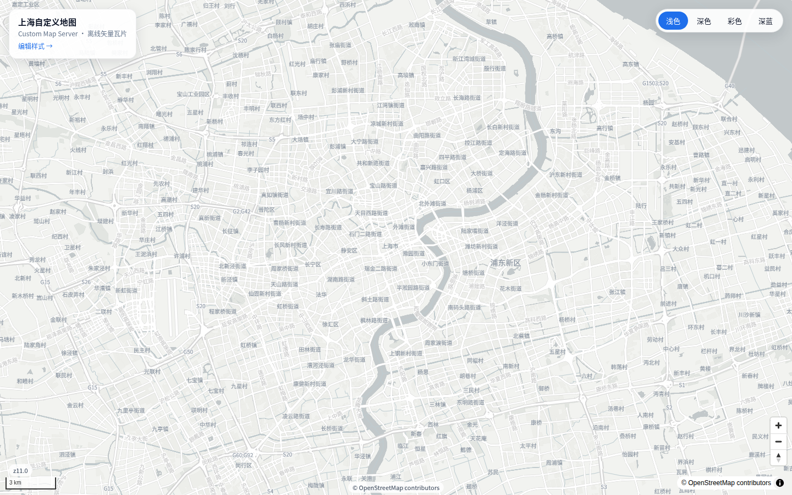
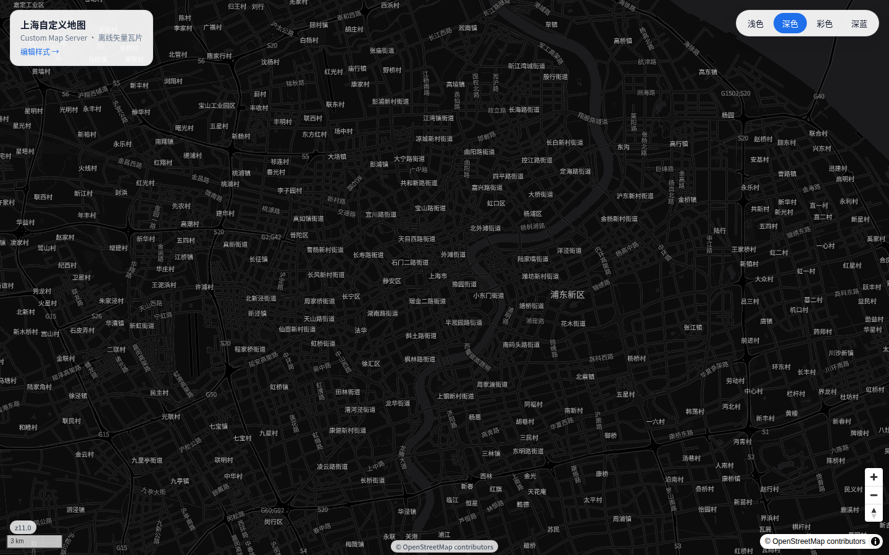
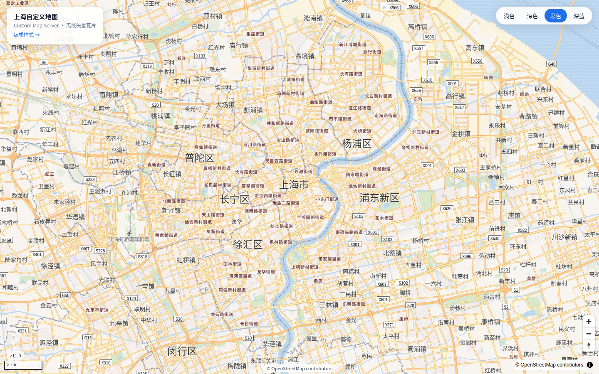
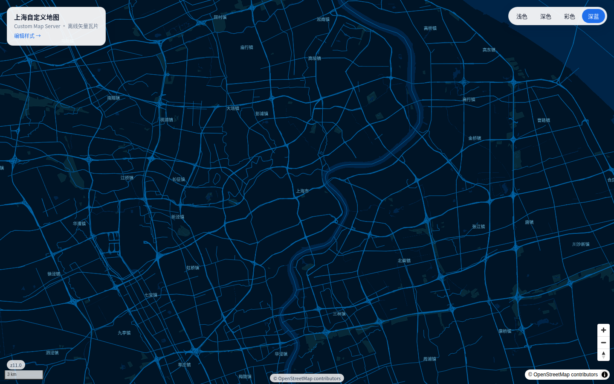
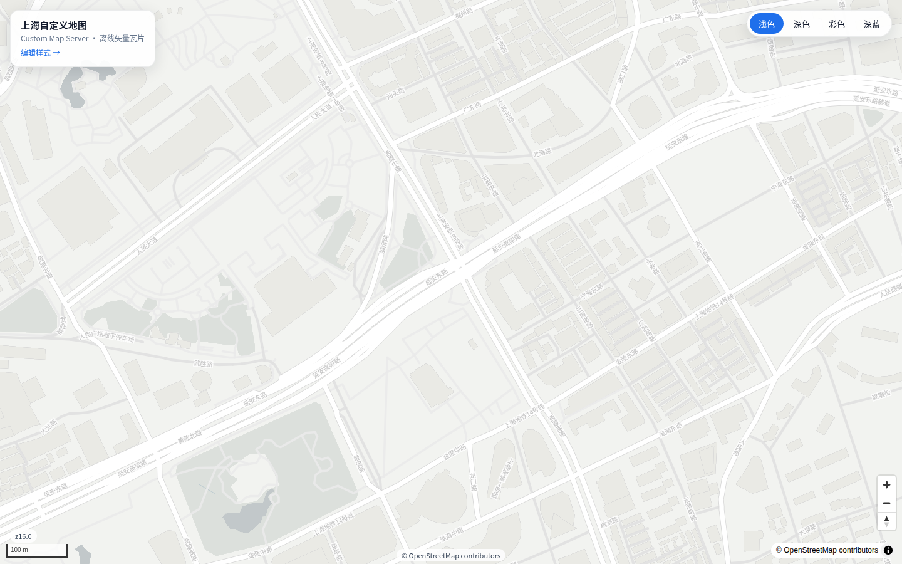
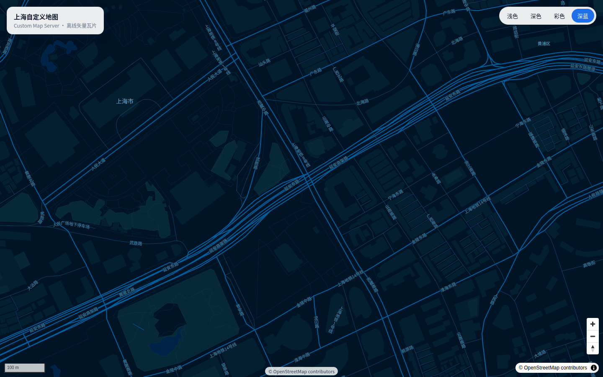
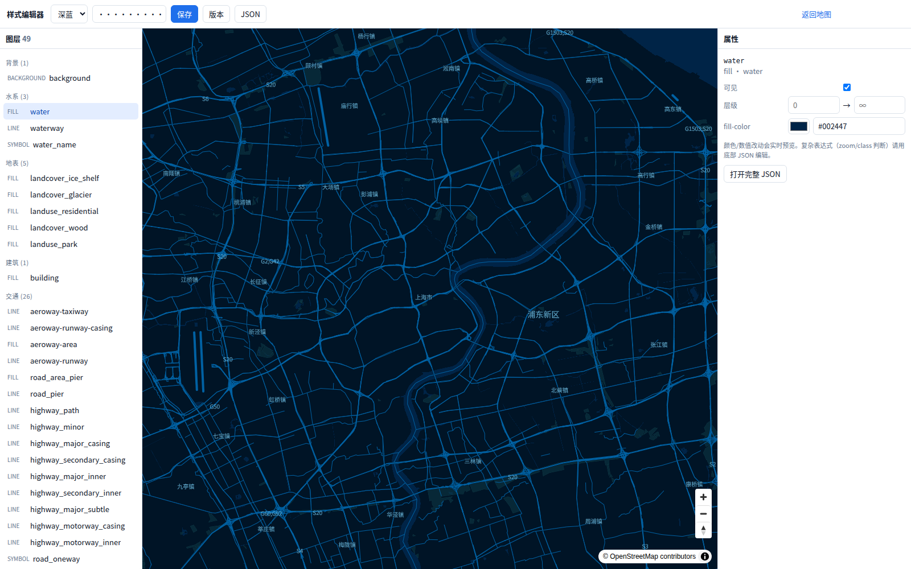

# 自定义样式地图服务（Custom Map Server）

一套**可私有化部署、可完全离线、数据与样式分离**的矢量地图服务。用 OpenStreetMap `.osm.pbf` 生成 PMTiles，用 TileServer GL 提供瓦片/样式/字体/图标，用 MapLibre GL JS 渲染，支持客户服务器部署。



## 为什么

- 百度/高德 API：接入快，但按量/商用付费，样式受平台限制，不能离线私有化。
- 本方案：软件全部开源、无按次费用、可断网运行；底图数据、样式、字体、图标各自独立，换数据不改样式，换样式不改数据。
- 已验证上海样例：`shanghai-latest.osm.pbf`（约 26 MB）→ PMTiles（约 26 MB）→ 四套样式（浅色/深色/彩色/深蓝）。

## 技术栈

| 环节 | 选型 |
|---|---|
| PBF → 矢量瓦片 | [tilemaker](https://github.com/systemed/tilemaker) 3.x（OpenMapTiles schema） |
| 瓦片/样式/字体/图标服务 | [TileServer GL](https://github.com/maptiler/tileserver-gl) 5.7 |
| 前端渲染 | [MapLibre GL JS](https://maplibre.org/maplibre-gl-js/) 6.x |
| 中文/拉丁字形 | Noto Sans CJK SC + [glyphore](https://github.com/Kartore/glyphore) |
| 图标雪碧图 | [spreet](https://github.com/flother/spreet) |
| 样式编辑（可选） | [Maputnik](https://github.com/maplibre/maputnik) |
| 部署 | Docker Compose + Nginx |

## 快速开始

前置：Linux、Docker 24+、Docker Compose v2、Node 20+、Python 3。

```bash
cp .env.example .env

# 1) 数据：上海 PBF + 海岸线（约 900MB，只需一次）
./run fetch shanghai
./run coastline

# 2) 生成 PMTiles、字体、图标、样式、服务配置
./run tiles
./run fonts
./run sprites
./run styles
./run config
./run check

# 3) 启动
./run up
./run verify
```

> 有 GNU make 时，`make <命令>` 与 `./run <命令>` 等价；没有 make 的环境（例如本机）直接用 `./run`。

打开 <http://localhost:8081/>，右上角可切换「浅色 / 深色 / 彩色 / 深蓝」。

直接看深蓝：<http://localhost:8081/?style=blueprint>。

| 浅色 | 深色 | 彩色 | 深蓝（Blueprint） |
|---|---|---|---|
|  |  |  |  |

z16 细节（建筑/街道/中文标注）：



深蓝 z16：



> 如果不用海面，可跳过 `./run coastline`，用 `COASTLINE=none ./run tiles` 构建（海面显示为背景色）。
>
> 本仓库在 WSL/受限环境下把 `DOCKER_CONFIG` 指向 `./.docker`（见 Makefile），避免 `~/.docker` 只读导致 buildx 失败。

## 常用命令

```bash
./run help          # 查看全部命令
./run bootstrap     # coastline + tiles + fonts + sprites + styles + config + check
./run up            # 构建并启动
./run logs          # 查看日志
./run verify        # HTTP 验收
./run zoom-matrix   # 生成 docs/zoom-matrix.md
./run down          # 停止
./run bundle        # 打离线部署包 dist/
```

## 可视化样式编辑器

打开 <http://localhost:8081/editor>（主地图左上角也有入口）：

- 左侧按图层分组（背景/水系/地表/建筑/交通/边界/地名）；
- 中间 MapLibre 实时预览；
- 右侧改颜色、线宽、透明度、可见性、minzoom/maxzoom；
- 点击地图要素可直接选中它所属的样式类型，并查看 class/name 等属性；
- 滚轮固定 ±1 级，顶部实时显示当前层级（如 `z11.0`）；
- 「AI」按钮：自然语言改样式，返回 JSON Patch + diff，预览确认后保存；
- 顶部保存、版本历史、完整 JSON 编辑；
- 保存写入 `styles/<id>.json`，主地图刷新即可看到，不需要重启 tileserver。



编辑令牌在 `.env` 的 `EDITOR_TOKEN`（默认 `change-me`，生产必须改）。AI 助手需要可选配置 `AI_BASE_URL` / `AI_API_KEY` / `AI_MODEL`，未配置时使用本地规则模式。版本自动备份到 `data/style-versions/<id>/`。

详见 [编辑器说明](docs/editor.md)。

## 已验证

- `./run check`：样式 spec、字体、图标、source-layer、数据引用全部通过（0 warning）。
- `./run verify`：健康检查、四套样式、PMTiles 瓦片、字体、sprite、前端页面全部 200。
- `node tests/smoke.mjs`：Chromium 实际渲染，四套样式切换、中文、瓦片加载、无控制台错误、无外部请求。
- `/editor`：Chromium 验证图层树、分组、颜色修改、保存、版本弹窗；保存后静态样式立即生效。
- `make bundle` / `./run bundle`：离线包在无网络、仅 Docker 的干净容器中安装并出图（见 `dist/README-offline.md`）。

## 目录与“数据/样式分离”

```
data/tiles/*.pmtiles      # 数据（矢量瓦片）
styles/*.json             # 样式（颜色/图层/字体）
styles/schema/            # 图层分组 schema
data/style-versions/      # 编辑器保存的版本
data/fonts/               # 字形
data/sprites/             # 图标
config/map.manifest.json  # 唯一绑定清单：style -> dataset
config/tileserver.config.json  # 由 manifest 生成
```

- 样式只引用 `/data/<dataset>/{z}/{x}/{y}.pbf`，不包含数据文件。
- 替换 `data/tiles/shanghai.pmtiles` 并重启 tileserver，数据更新、样式不变。
- 修改 `styles/light.json` 并刷新页面，样式变化、数据不变（静态样式）。
- 新增/删除样式或数据集，只改 `config/map.manifest.json`，再 `./run config`。

详见 [架构说明](docs/architecture.md) 与 [样式指南](docs/styles.md)。

## 离线部署

```bash
./run bundle
# 将 dist/ 拷到客户服务器（可断网）
cd dist && ./install.sh
```

客户机只需要 Docker + Docker Compose v2，不需要 Node/Python/外网。详见 [离线部署](docs/deployment-offline.md)。

## 后续路线

- **内容/样式工程**：图层分组、zoom matrix 校验、样式版本化（已完成基础版）；
- **可视化编辑器**：图层树 + 图形化属性 + JSON 编辑器 + 实时预览 + 保存/版本（MVP 已完成）；
- **AI 助手**：自然语言 → JSON Patch → 校验 → diff → 确认；
- **标准服务**：矢量 XYZ/TileJSON 已有；栅格/WMTS 需先解决 CJK 字形的 native 渲染兼容；
- **数据与 POI**：PMTiles 下载/本地加载、POI 搜索/高亮、地理编码；
- **引擎适配**：Cesium（栅格/地形）、百度/高德（坐标偏移 + 合规）。

详见 [路线图](docs/roadmap.md) 与 [标准服务与引擎适配](docs/services.md)。

## 生产注意事项

- 设置 `.env` 里的 `PUBLIC_URL` 为客户端实际访问地址（含末尾 `/`），并在反向代理上配置 HTTPS。
- 修改 `EDITOR_TOKEN`，不要把默认令牌带到生产；不需要编辑器时可在 Nginx 关闭 `/editor` 与 `/api/`。
- `ALLOWED_HOSTS` 设置为实际域名，避免 Host 头污染。
- 公网发布地图在中国涉及审图号/地图审核；OSM 为 WGS-84，与百度 BD-09/高德 GCJ-02 存在偏移。本样例不做坐标偏移，详见 [调研报告](docs/research.md)。
- OSM 数据许可为 ODbL 1.1，界面必须保留 “© OpenStreetMap contributors”。

## 许可

代码见各目录；数据/样式/字体许可见 [NOTICE.md](NOTICE.md)。OSM 数据 © OpenStreetMap contributors，ODbL 1.1。
