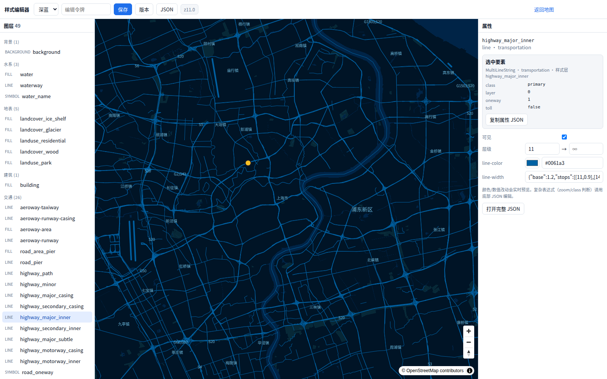
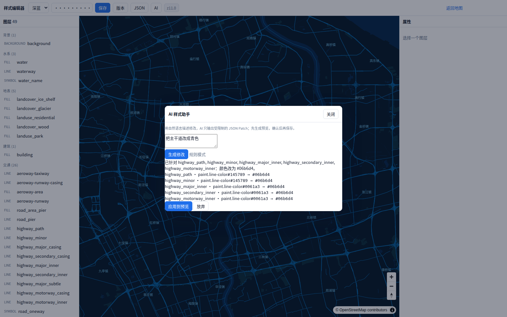

# 可视化样式编辑器

地址：`http://<host>:8081/editor`（主地图左上角也有「编辑样式 →」入口）


## 1. 能做什么

- 左侧：按「背景 / 水系 / 地表 / 建筑 / 交通 / 边界 / 地名」分组的图层树；
- 中间：MapLibre 实时预览；
- 右侧：可见性、minzoom/maxzoom、颜色、线宽、透明度等常用属性；
- 顶部：样式切换、保存、版本历史、JSON 按钮、当前层级（如 `z11.0`）；
- 点击地图上的要素：自动选中它所属的样式图层，并在右侧显示 `geometry / source-layer / 样式层` 和属性（class、name、ref 等）；
- 滚轮一次 = 一个整数层级（不是连续缩放）；
- 「JSON」抽屉：直接编辑完整 Style JSON，格式化/应用；
- 保存后写入 `styles/<id>.json`，主地图刷新即可看到（样式由 Nginx 静态提供，不需要重启 tileserver）。

## 2. 编辑令牌

编辑 API 默认要求令牌：

```ini
# .env
EDITOR_TOKEN=change-me
```

在编辑器顶部输入同一个令牌即可保存/查看版本。

- 生产必须改成强随机值，并通过 HTTPS 访问；
- 令牌只存在浏览器 `sessionStorage`；
- 编辑器容器以 `EDITOR_UID:EDITOR_GID`（默认 1000:1000）运行，需要能写 `styles/` 与 `data/style-versions/`；宿主 uid 不同时改 `.env`；
- 不要在没有鉴权的情况下把 `/editor` 暴露到公网。

## 3. 保存与版本

- 保存时先做 MapLibre Style Spec 校验；
- 校验通过后原子写入 `styles/<id>.json`；
- 每次保存自动在 `data/style-versions/<id>/` 留一个版本；
- 「版本」里可以恢复任意历史版本（恢复前会先备份当前版本）；
- 版本目录需要纳入备份策略。

> `./run styles` 会从 `styles/vendor/` + manifest 重新生成 `styles/*.json`，会覆盖编辑器保存的内容。长期定制请：
> 1. 在编辑器里改好后导出/复制 JSON；
> 2. 把改动回写到 `styles/vendor/` 或新增自己的 base，再 `./run styles`；
> 或把编辑器作为唯一的修改入口，不再跑 `./run styles`。

## 4. 点击要素与层级



- 点击地图要素：选中对应样式层（例如点一条主干道，会选中 `highway_major_inner`），右侧显示该要素的属性；地图上出现一个黄色标记点。
- 瓦片里的线要素可能被合并成一条 MultiLineString，所以不只高亮“你点的那一段”，而是用标记点 + 属性面板定位；改样式仍然作用于该类型全部要素。
- 滚轮：每次滚轮固定 ±1 级；顶部 `z11.0` 实时显示当前层级。
- 层级与图层矩阵见 [zoom-matrix.md](zoom-matrix.md)。

## 5. API

所有写接口都需要 `Authorization: Bearer <EDITOR_TOKEN>`。

| 方法 | 路径 | 说明 |
|---|---|---|
| GET | `/api/health` | 健康检查 |
| GET | `/api/manifest` | 样式清单 |
| GET | `/api/styles` | 样式列表 + 版本数 |
| GET | `/api/styles/<id>` | 读取样式 JSON |
| GET | `/api/styles/<id>/versions` | 版本列表 |
| PUT | `/api/styles/<id>` | 保存样式（校验后写入） |
| POST | `/api/styles/<id>/validate` | 只校验，不写入 |
| POST | `/api/styles/<id>/restore` | 恢复 `{ "version": "..." }` |
| POST | `/api/styles/<id>/ai` | AI 样式修改：`{ "prompt": "...", "style": {...} }` |

示例：

```bash
TOKEN=change-me
curl -H "Authorization: Bearer $TOKEN" \
  http://localhost:8081/api/styles/blueprint

curl -X PUT \
  -H "Authorization: Bearer $TOKEN" \
  -H "Content-Type: application/json" \
  --data-binary @styles/blueprint.json \
  http://localhost:8081/api/styles/blueprint
```

## 6. 架构

```
浏览器 /editor
  ├─ GET /styles/<id>/style.json   Nginx 静态（实时）
  ├─ GET /styles/schema/*.json     Nginx 静态
  └─ PUT /api/styles/<id>          Nginx → editor-api
                                      ├─ Style Spec 校验
                                      ├─ styles/<id>.json（rw 挂载）
                                      └─ data/style-versions/<id>/
```

- `editor` 服务：Node 24，镜像 `custom-map-editor-api`；
- `styles` 对 editor 读写、对 web 只读；
- `data/style-versions` 对 editor 读写；
- 主地图和编辑器读同一份静态样式，保存后刷新即生效。

## 7. AI 助手



顶部「AI」按钮：

1. 输入自然语言，例如“把主干道改成青色”“隐藏村庄名称”；
2. 服务端返回受限制的 **RFC 6902 JSON Patch** + 说明 + diff；
3. 前端只把 patch 应用到副本，MapLibre 预览；
4. 确认后点「应用到预览」，再点顶部「保存」。

安全约束：

- 只允许修改 `/layers/<index>/(paint|layout|minzoom|maxzoom|filter)`；
- 不允许改 `sources` / `glyphs` / `sprite` / `metadata`；
- 服务端再次用 Style Spec 校验；
- AI 不执行代码。

配置（`.env`）：

```ini
AI_BASE_URL=https://api.openai.com/v1   # OpenAI 兼容端点
AI_API_KEY=sk-...
AI_MODEL=gpt-4o-mini
```

不配置 `AI_API_KEY` 时使用本地规则模式，支持常见颜色/隐藏/显示/线宽请求；复杂需求需要接模型。

## 8. 当前限制

- AI 已支持 JSON Patch + 校验 + diff + 预览；LLM 需要配置 `AI_API_KEY`，未配置时是规则模式；
- 没有多用户/协作/审批流；
- 没有图层新增/删除的可视化操作（可用 JSON 面板做）；
- 复杂表达式仍建议用 JSON 编辑；
- 样式保存是整份覆盖，不是字段级 patch（版本目录可回滚）。
