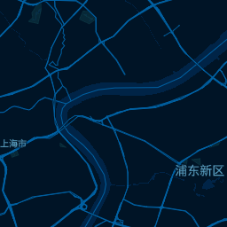

# 标准地图服务与引擎适配

## 1. 当前已可用

| 服务 | 地址 | 说明 |
|---|---|---|
| 矢量瓦片 XYZ | `/data/<dataset>/{z}/{x}/{y}.pbf` | MapLibre/Leaflet/OpenLayers 直接可用 |
| TileJSON | `/data/<dataset>.json` | 标准 TileJSON 2.0 |
| Style JSON | `/styles/<id>/style.json` | MapLibre Style Spec v8 |
| 字体 | `/fonts/<fontstack>/<range>.pbf` | SDF glyph |
| 图标 | `/sprites/<id>/sprite[@2x].{json,png}` | Nginx 静态 |
| 栅格 XYZ | `/styles/<id>_raster/{z}/{x}/{y}.png` | TileServer GL native 渲染 |
| WMTS | `/styles/<id>_raster/wmts.xml` | 栅格 + WMTS |
| 健康检查 | `/health` | 监控/负载均衡 |
| 样式列表 | `/styles.json` | 调试/目录 |
| 服务目录 | `/api/catalog` | 数据集/样式/服务地址/许可 |

示例：

```bash
curl http://localhost:8081/data/shanghai.json
curl http://localhost:8081/data/shanghai/12/3430/1673.pbf
curl http://localhost:8081/styles/blueprint/style.json
```

这些是标准 HTTP 接口，不依赖本前端；QGIS/Leaflet/OpenLayers/Cesium 都可以直接接。`/data`、`/fonts`、`/sprites`、`/styles` 已加 `Access-Control-Allow-Origin: *`，便于其他域名的地图客户端访问。

## 2. 栅格 / WMTS（已可用）

TileServer GL 完整版具备服务端栅格渲染和 WMTS，`blueprint` 已生成 raster 专用样式：

```
/styles/blueprint_raster/{z}/{x}/{y}.png
/styles/blueprint_raster/wmts.xml
/styles/blueprint_raster/static/...
```

示例：

```bash
curl -o tile.png http://localhost:8081/styles/blueprint_raster/12/3430/1673.png
curl http://localhost:8081/styles/blueprint_raster/wmts.xml
```



实现要点：

- raster 样式由 `build-styles` 额外生成 `styles/<id>-raster.json`；
- 数据源使用 `pmtiles://<dataset>`，由 TileServer GL 内部解析；
- `glyphs` 写成 `{fontstack}/{range}.pbf`（不能带前导 `/`，否则 native 会拼成 `fonts:///fonts/...` 并报 `Invalid font name`）；
- `sprite` 写成 `<styleId>/sprite`（相对 `paths.sprites`）；
- 字体使用无空格 fontstack 名（`NotoSansSC-Regular/Bold`），避免 native 请求路径问题；
- Nginx 把 `/styles/<id>_raster/{z}/{x}/{y}.png` 和 `wmts.xml` 代理到 TileServer GL，样式 JSON 仍然静态服务。

要开启其他样式的栅格，在 `config/map.manifest.json` 对应 style 加 `"render": true`，然后 `./run styles config` 并重启 tileserver。

> 栅格渲染比矢量瓦片重，生产建议独立进程/资源限制，或只对 Cesium/QGIS 等需要的样式开启。

## 3. 引擎兼容性

| 引擎 | 接入方式 | 备注 |
|---|---|---|
| MapLibre GL JS | 矢量 XYZ + Style JSON | 本项目默认 |
| Leaflet | 矢量瓦片需插件（maplibre-gl-leaflet / vectorgrid）；或栅格 XYZ | 栅格更简单 |
| OpenLayers | MVT source + Style JSON | 原生支持 |
| QGIS | XYZ 栅格 / WMTS / 矢量瓦片（MVT） | 可用 |
| ArcGIS | WMTS / XYZ 栅格 | 可用 |
| CesiumJS | XYZ/WMTS 栅格 + DEM 地形 | Cesium 原生不渲染 MVT；3D Tiles 另做 |
| 百度地图 JS | 自定义栅格图层/Overlay | 需 BD-09 偏移 + 合规评估 |
| 高德地图 JS | 自定义栅格图层/Overlay | 需 GCJ-02 偏移 + 合规评估 |
| 微信小程序/App | MapLibre Native / 栅格服务 | 需端上适配 |

### Cesium 示例

```js
const imagery = new Cesium.UrlTemplateImageryProvider({
  url: 'https://map.example.com/styles/blueprint_raster/{z}/{x}/{y}.png',
  tilingScheme: new Cesium.WebMercatorTilingScheme(),
  maximumLevel: 14,
});
viewer.imageryLayers.addImageryProvider(imagery);
```

### 百度/高德

它们不是“标准 XYZ + WGS-84”引擎：

- 百度使用 BD-09，高德使用 GCJ-02；
- 直接把 WGS-84 的 OSM 瓦片叠上去会有几十到几百米偏移；
- 需要做坐标转换（数据生产阶段偏移，或服务端栅格重投影），并评估地图合规。

因此“支持百度/高德”本质是**坐标转换 + 栅格服务 + 合规**三件事，不是换一个 URL 就能完成。

## 4. 建议补齐

- `/api/catalog`：数据集/样式/服务地址/坐标系/许可；
- 标准服务文档 + QGIS/Leaflet/Cesium 示例；
- 栅格渲染的独立进程/资源限制；
- CORS、缓存、限流、鉴权；
- OGC API Tiles（可选 Martin）；
- 栅格服务的进程隔离与资源限制。
